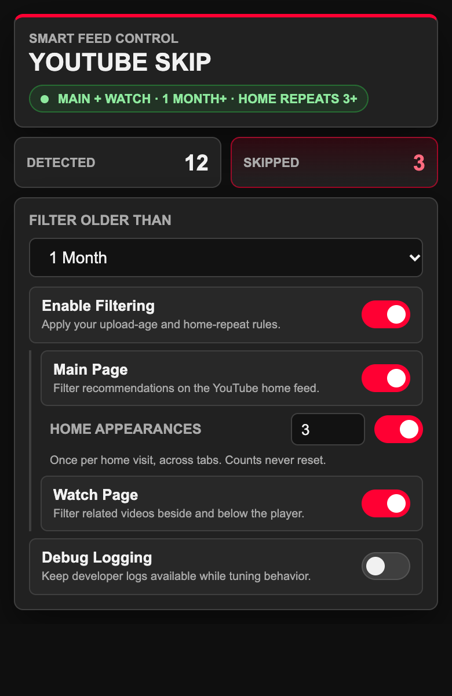
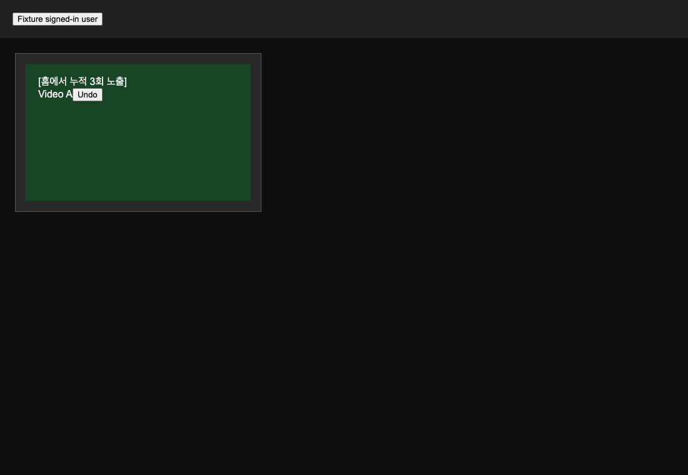

# Cumulative home appearances

Use a test YouTube account for live verification: submitted feedback changes recommendations.
Run the scenarios in English and Korean. Use recent videos below the upload-age threshold so
the age rule does not submit feedback before the repeat rule can be tested.

## Settings and appearance counting

1. Reload the extension and YouTube. Confirm the Home appearances switch starts OFF with a count of 3.
2. Enable the global, Main Page, and Home appearances switches. Confirm 2 and larger integers save;
   empty, fractional, negative, and 1 values show validation and do not change the saved setting.
3. Identify video A with at least half its card on screen. Scroll away and back several times.
   Confirm this visit records A once and does not submit repeat feedback below N.
4. Refresh the home feed using the logo, then expose A again. Confirm the total becomes 2.
5. On the next home visit, keep A offscreen or use a feed without A. Confirm its total stays 2.
6. On a fourth visit, expose A. Confirm one interest-feedback action and a hidden result showing
   `[홈에서 누적 3회 노출]` with A's title. Confirm Skipped increases only after the result appears.
7. Repeat with cards reached by scrolling. Loaded cards below the viewport and cards in a hidden
   tab must not be counted until the tab is visible and at least half the card is on screen.

Counts can be inspected in the extension service worker console without editing storage:

```javascript
chrome.storage.local.get('home_exposure_history').then(console.log);
```

## Visits, settings, and persistence

1. Change N and the upload-age threshold, toggle filtering OFF/ON, and switch tabs. Confirm these
   operations do not add appearances to the same visit. Lowering N re-evaluates already seen cards.
2. Test home → watch → home, browser Back/Forward, a full reload, and a home logo refresh.
   Each completed home visit counts a visible video once, even with duplicate navigation events.
3. Expose A on a second visible home tab. Confirm the profile total increases once for that tab's
   visit; returning to the first tab does not add another appearance.
4. Stop the service worker, resume use, and reopen the browser. Confirm committed totals survive.
   A new page visit can add one appearance, while retries in an existing visit cannot add another.
5. Disable Home appearances, Main Page, or the global switch during pending work. Confirm repeat
   actions and new records stop. Existing counts remain. Re-enable and confirm no duplicate count.
6. Sign out and confirm no recording or feedback. Sign in and check normal activation.
7. Raise N while repeat actions are queued. Confirm cards below the new N are not processed by
   the repeat rule; cards matching the independent age rule may still be processed.

## Regression and UI

1. Confirm `/watch` age filtering and existing home age filtering still work with repeat OFF.
2. When both rules match, confirm one action and one Skipped increment for the target card.
3. Confirm missing menu actions and unconfirmed results do not count as skipped or erase totals.
4. Confirm hidden-result Undo controls work and neighboring cards keep their own text.
5. Check the popup at normal zoom: labels, number input, disabled states, error text, and keyboard
   focus must fit within the popup without clipping. Capture the updated popup and hidden reason.
6. Check the browser console for extension errors after navigation and settings changes.

## Verification record

- 2026-10-31: all 79 Node tests and the extension reference/syntax check passed.
- Local Chrome fixture: actual DOM/IntersectionObserver plus background, content scripts, and inject.js
  confirmed A counts 1 → 2 → 2 → 3, one feedback command, one Skipped, the repeat reason, and Undo.
  Repeated scrolling, recycled DOM, and popstate/start/finish ordering did not double-count visits.
  All routes were fulfilled locally, with no live YouTube requests or console/page errors.
- Popup at 390px width: enabled/default height 538px, save error 557px, signed out 600px; no clipping.
- Live signed-in YouTube verification: pending; the automated DOM fixtures cannot establish whether
  YouTube has changed its card selectors or account-specific feedback behavior.


## Local fixture screenshots

The popup uses mocked settings and authentication. The hidden-result card is a synthetic home
fixture showing the extension's actual reason rendering; it is not a capture of live YouTube.




